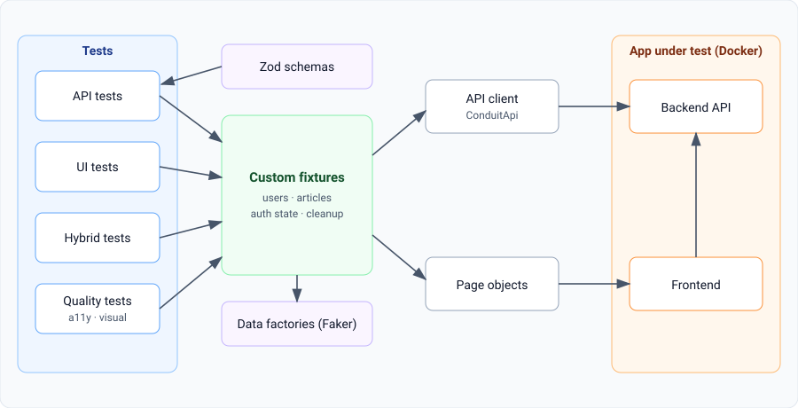
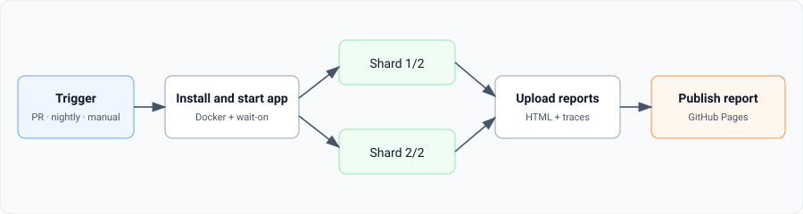

<div align="center">

# 🎭 Conduit Playwright Framework

**A UI + API test automation framework built with Playwright and TypeScript.**


</div>

---

## 📑 Table of Contents

- [Why this project](#-why-this-project)
- [What is covered](#-what-is-covered)
- [Architecture](#%EF%B8%8F-architecture)
- [Quick start](#-quick-start)
- [Run the tests](#-run-the-tests)
- [Project structure](#-project-structure)
- [CI/CD pipeline](#%EF%B8%8F-cicd-pipeline)
- [Results](#-results)
- [Roadmap](#%EF%B8%8F-roadmap)
- [Troubleshooting](#-troubleshooting)
- [About the author](#-about-the-author)

---

## 🎯 Why this project

Most test repos are a pile of scripts. This one is built the way a real team would build a framework:

- Tests own their data through **custom fixtures**, so they run in parallel without stepping on each other.
- **API-driven setup** keeps UI tests fast and stable.
- **Schema validation** catches API contract changes, not just status codes.
- Everything runs from a **single command locally** and in **sharded CI**.

The app under test is [Conduit (RealWorld)](https://github.com/gothinkster/realworld), an open-source Medium clone with a documented REST API, run locally in Docker.

---

## ✅ What is covered

<details open>
<summary><b>🔌 API tests</b> (14)</summary>

<br>

- **Register:** valid user (`201` + schema), duplicate email/username, invalid email, blank fields (`422`)
- **Login:** valid credentials, wrong password, unknown email (`422`)
- **Current user:** valid token, missing token, malformed token (`401`)
- **Articles:** create (schema-validated), create without a token (`401`), empty title (`422`), deleted article returns `404`
- **Schema validation** of user and article responses with Zod
- Each test creates its own user through a fixture, so there is no shared state

</details>

<details>
<summary><b>🖥️ UI tests</b> (2 + login setup)</summary>

<br>

- Page Object Model: `LoginPage`, `HomePage`, `EditorPage`
- Login performed once in a setup project and reused with `storageState`
- Publish an article through the editor
- Locators based on roles and placeholders (no brittle CSS chains)

</details>

<details>
<summary><b>🛡️ Resilience tests</b></summary>

<br>

- Network interception with `page.route`
- Simulated `500` from the articles API; asserts the home page still renders an empty state

</details>

<details>
<summary><b>♿ Accessibility and 👁️ Visual tests</b> (written, not yet wired into a project)</summary>

<br>

- Accessibility scan with `@axe-core/playwright` (WCAG 2 A/AA), failing on serious/critical violations
- Screenshot comparison with `toHaveScreenshot`
- These live in `tests/quality/` but no Playwright project includes that folder yet. See the [Roadmap](#%EF%B8%8F-roadmap).

</details>

---

## 🏗️ Architecture

<p align="center">
  
</p>

**Key design ideas**

| Idea | Why |
|---|---|
| Fixtures instead of a base test class | Composable, lazily created, automatic teardown |
| Fresh user per test | Full isolation and safe parallelism |
| API for setup, UI for verification | Faster and less flaky tests |
| `*Raw` client methods return the response | Negative tests can assert on status and body |
| Tags on tests (`@api`, `@smoke`) | Run a subset with `--grep` |

**Playwright projects** (in `playwright.config.ts`)

| Project | Runs | Notes |
|---|---|---|
| `api` | `tests/api/` | No browser, uses `API_URL` |
| `setup` | `tests/setup/auth.setup.ts` | Registers a user via API, logs in via UI, saves `.auth/user.json` |
| `ui` | `tests/ui/` | Desktop Chrome, `UI_URL`, reuses the saved login; depends on `setup` |

---

## 🚀 Quick start

### 1. Prerequisites

| Tool | Check |
|---|---|
| Node.js (LTS) | `node -v` |
| Git | `git --version` |
| Docker + Compose | `docker compose version` |

Java and an old Node version for the frontend are **not** needed on your machine. Both apps build inside Docker.

### 2. Clone and install

```bash
git clone https://github.com/Bhuvanyu02/Conduit-Playwright-Framework.git
cd Conduit-Playwright-Framework
npm ci
npx playwright install --with-deps chromium
```

### 3. Start the app under test

Clone the backend and frontend **next to** this repo, then build both with the `docker-compose.yml` in this repo:

```bash
git clone https://github.com/drakulavich/spring-boot-realworld-example-app.git ../backend
git clone https://github.com/drakulavich/react-redux-realworld-example-app.git ../frontend

docker compose up -d --build
npx wait-on http-get://localhost:8080/tags http-get://localhost:4100
```

| Service | URL | Check |
|---|---|---|
| Backend (Spring Boot + SQLite) | http://localhost:8080 | `curl http://localhost:8080/tags` → `{"tags":[]}` |
| Frontend (React + Redux) | http://localhost:4100 | Open in a browser |

The first build takes a few minutes (Gradle and npm downloads). Later starts take seconds.

> 💡 Neither upstream repo ships a Dockerfile, so `docker-compose.yml` defines both builds inline. It also points the frontend at `http://localhost:8080` (upstream uses a public demo API) and limits the backend to one SQLite connection so parallel tests don't fail with `database is locked`.
>
> CI pins the commits it tested against: backend `82da704`, frontend `ee72eba`. Run `git -C ../backend checkout 82da704` (and the same for the frontend) to match.

Clones somewhere else? Set `BACKEND_DIR` and `FRONTEND_DIR`:

```bash
BACKEND_DIR=~/code/backend FRONTEND_DIR=~/code/frontend docker compose up -d --build
```

### 4. Configure the environment

```bash
cp .env.example .env
```

```text
UI_URL=http://localhost:4100
API_URL=http://localhost:8080/
```

> ⚠️ This backend serves the API at the root (`/users`, `/articles`), **not** under `/api`. Keep the trailing slash: client paths such as `'articles'` have no leading slash, so they resolve relative to `API_URL`.

### 5. Run

```bash
npm test
npx playwright show-report
```

### 6. Stop

```bash
docker compose down        # keep images for a fast restart
docker compose down --rmi local   # also remove the built images
```

---

## 🧪 Run the tests

<details open>
<summary><b>Common commands</b></summary>

<br>

| Goal | Command |
|---|---|
| Everything (17 tests) | `npm test` |
| API tests only (14) | `npm run test:api` |
| UI tests only (setup + 2) | `npm run test:ui` |
| Smoke suite (setup + 4) | `npm run test:smoke` |
| Debug visually | `npx playwright test --ui` |
| Headed mode | `npx playwright test --headed` |
| Step through a test | `npx playwright test --project=ui --debug` |
| One file | `npx playwright test tests/api/auth.api.spec.ts` |
| One shard | `npx playwright test --shard=1/2` |
| Open last report | `npx playwright show-report` |
| Inspect a trace | `npx playwright show-trace test-results/<test>/trace.zip` |

Running `--project=ui` also runs `setup` first, because `ui` depends on it.

</details>

<details>
<summary><b>🏷️ Tag reference</b></summary>

<br>

| Tag | Meaning | Tests |
|---|---|---|
| `@smoke` | Critical happy paths | Register, login, create article (API); publish article (UI) |
| `@api` | API-level tests | All 14 API tests |
| `@a11y` | Accessibility scans | Written, not yet in a project |
| `@visual` | Screenshot comparisons | Written, not yet in a project |

Example: `npx playwright test --grep "@smoke"`

</details>

---

## 📁 Project structure

<details>
<summary><b>Click to view the folder layout</b></summary>

<br>

```text
Conduit-Playwright-Framework/
├── .github/workflows/
│   ├── test.yml                    # Sharded CI pipeline (PRs, nightly, manual)
│   └── playwright.yml              # Default Playwright workflow (targets master)
├── docker-compose.yml              # Builds and runs the app under test
├── src/
│   ├── api/conduit-cleint.ts       # ConduitApi client (register, login, articles, current user)
│   ├── data/factories.ts           # Faker-based buildUser / buildArticle
│   ├── fixtures/index.ts           # api, authedApi, article fixtures
│   ├── pages/                      # LoginPage, HomePage, EditorPage
│   └── schemas/                    # Zod schemas: article, user
├── tests/
│   ├── setup/auth.setup.ts         # Log in once, save storageState
│   ├── api/                        # auth.api.spec.ts, articles.api.spec.ts
│   ├── ui/                         # articles.ui.spec.ts, resilience.ui.spec.ts
│   ├── hybrid/                     # API + UI specs (placeholder)
│   └── quality/                    # a11y and visual specs (not yet wired)
├── docs/                           # architecture.svg, ci-pipeline.svg
├── playwright.config.ts
├── .env.example
└── README.md
```

</details>

---

## ⚙️ CI/CD pipeline

<p align="center">
  
</p>

`.github/workflows/test.yml`:

- **Triggers:** every pull request, nightly at 02:00 UTC, and manual (`workflow_dispatch`)
- **App under test:** clones both apps at pinned commits and runs `docker compose up -d --build`
- **Sharding:** the full suite split across 2 parallel jobs (`--shard=1/2`, `--shard=2/2`)
- **Failures:** 2 retries in CI, traces captured on first retry, app logs printed when the job fails
- **Artifacts:** HTML report uploaded per shard, kept 14 days

---

## 📈 Results

Measured locally (Apple Silicon, apps in Docker):

| Metric | Value |
|---|---|
| Total tests | 17 |
| API / UI / Setup / Hybrid | 14 / 2 / 1 / 0 |
| Suite runtime, single worker | ~8.5 s |
| Suite runtime, parallel | ~6.5 s |
| Shards | 8 + 9 tests |
| Flaky tests fixed | 1: parallel article writes returned `500` from SQLite locking; fixed with a single DB connection (60/60 repeats pass) |

---

## 🗺️ Roadmap

**Foundation**
- [x] Project scaffold and Playwright config
- [x] App under test running in Docker
- [x] API client, factories, and fixtures

**Coverage**
- [x] API suite with schema validation (auth, articles)
- [x] UI suite with page objects
- [x] Network mocking and resilience tests
- [ ] More API coverage: update article, comments, favourites, `403` on another user's article
- [ ] UI tests using `LoginPage` / `HomePage` (login errors, feeds, tag filter)
- [ ] Hybrid API + UI tests (`tests/hybrid/article-flow.spec.ts` is empty)
- [ ] Wire `tests/quality/` into a project: accessibility scans and visual regression

**Delivery**
- [x] Tagged smoke suite
- [x] Sharded GitHub Actions pipeline
- [ ] Smoke-only on pull requests, full regression nightly
- [ ] Report published to GitHub Pages
- [ ] ESLint and Prettier configs, pre-commit hooks (`husky` and `lint-staged` are installed but not configured)

**Stretch ideas**
- [ ] Contract testing against the RealWorld API spec
- [ ] Basic performance thresholds on key endpoints
- [ ] Cross-browser matrix (Firefox, WebKit)
- [ ] Test data seeding script for local demos

---

## 🩺 Troubleshooting

<details>
<summary><b><code>ECONNREFUSED</code> on port 8080</b></summary>

<br>

The backend takes ~20 seconds to start after `docker compose up` (or after Docker Desktop restarts). Wait for it before running tests:

```bash
npx wait-on http-get://localhost:8080/tags http-get://localhost:4100
```

</details>

<details>
<summary><b>API calls return 404</b></summary>

<br>

Check that `API_URL` is `http://localhost:8080/` with **no** `/api` and **with** a trailing slash. Without the slash, `new URL('users', 'http://host/api')` drops the last segment.

</details>

<details>
<summary><b>Random <code>500</code> errors on article tests</b></summary>

<br>

SQLite rejects concurrent writes. Make sure you started the backend with this repo's `docker-compose.yml`, which sets `SPRING_DATASOURCE_HIKARI_MAXIMUM_POOL_SIZE=1`. Check the logs with `docker compose logs backend | grep SQLITE_BUSY`.

</details>

<details>
<summary><b>UI shows no data / login fails silently</b></summary>

<br>

The frontend must call `http://localhost:8080`, not the public demo API. Rebuild it: `docker compose up -d --build frontend`.

Note: on a wrong password the backend returns `{"message": ...}`, which this frontend does not display. The page simply stays on `/login`.

</details>

<details>
<summary><b>Port already in use</b></summary>

<br>

Run `docker ps` to find the old container, then `docker stop <id>`. Or change the host port in `docker-compose.yml` and update `.env`.

</details>

<details>
<summary><b>UI tests start logged out</b></summary>

<br>

Confirm `.auth/user.json` exists and that the `ui` project in `playwright.config.ts` depends on the `setup` project.

</details>

<details>
<summary><b>Visual tests fail only in CI</b></summary>

<br>

Screenshots differ by operating system. Generate baselines in CI (or the official Playwright Docker image) and mask dynamic regions such as dates and usernames.

</details>

---

## 👤 About the author

**Bhuvanyu Guru** · SDET Automation Engineer

[LinkedIn](https://www.linkedin.com/in/bhuvanyu02) · [GitHub](https://github.com/Bhuvanyu02)

> If this project helped you, consider giving it a ⭐

---

<div align="center">

Built with Playwright, TypeScript, and Docker.

</div>
