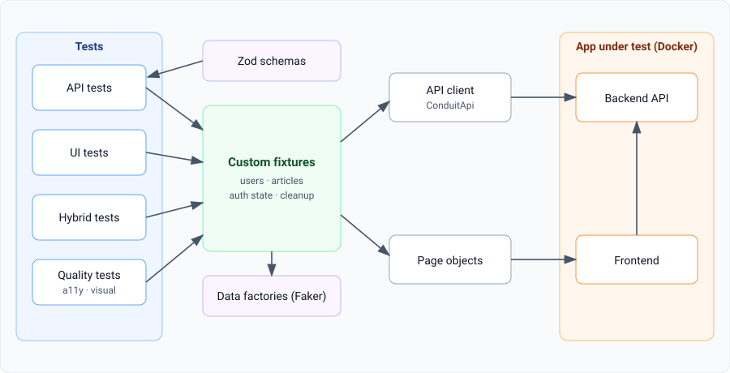
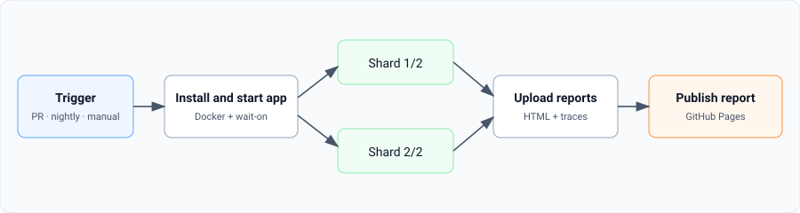

<div align="center">

# 🎭 Conduit Playwright Framework

**A production-style UI + API test automation framework built with Playwright and TypeScript.**


[📊 Live Test Report](https://Bhuvanyu02.github.io/conduit-playwright-framework/) · [🧠 Design Decisions](./DECISIONS.md) · [🐞 Flaky Test Log](./FLAKY-LOG.md)

</div>

---

## 📑 Table of Contents

- [Why this project](#-why-this-project)
- [What is covered](#-what-is-covered)
- [Architecture](#-architecture)
- [Quick start](#-quick-start-5-minutes)
- [Run the tests](#-run-the-tests)
- [Project structure](#-project-structure)
- [CI/CD pipeline](#-cicd-pipeline)
- [Results](#-results)
- [Roadmap](#-roadmap)
- [Troubleshooting](#-troubleshooting)
- [About the author](#-about-the-author)

---

## 🎯 Why this project

Most test repos are a pile of scripts. This one is built the way a real team would build a framework:

- Tests own their data through **custom fixtures**, so they run in parallel without stepping on each other.
- **API-driven setup** keeps UI tests fast and stable.
- The same suite checks **functionality, resilience, accessibility, and visual stability**.
- Everything runs from a **single command locally** and in **sharded CI**.

The app under test is [Conduit (RealWorld)](https://github.com/gothinkster/realworld), an open-source Medium clone with a documented REST API, run locally in Docker.

---

## ✅ What is covered

<details>
<summary><b>🔌 API tests</b> (click to expand)</summary>

<br>

- Authentication: register, login, duplicate email, wrong password
- Articles: create, read, update, delete
- Comments and favourites
- Negative cases: `401`, `403`, `404`, `422`
- **Schema validation** of responses with Zod
- Each test creates its own user through a fixture, so there is no shared state

</details>

<details>
<summary><b>🖥️ UI tests</b></summary>

<br>

- Page Object Model with thin, reusable page classes
- Login performed once and reused with `storageState`
- Article publish, edit, delete flows
- Locators based on roles, labels, and placeholders (no brittle CSS chains)

</details>

<details>
<summary><b>🔀 Hybrid tests</b></summary>

<br>

- Create data through the API, verify it in the UI
- Edit in the UI, verify through the API
- Proves both layers agree with each other

</details>

<details>
<summary><b>🛡️ Resilience tests</b></summary>

<br>

- Network interception with `page.route`
- Simulated `500` errors, slow responses, and empty lists
- Asserts that the UI degrades gracefully

</details>

<details>
<summary><b>♿ Accessibility and 👁️ Visual tests</b></summary>

<br>

- Automated accessibility scans with `@axe-core/playwright` (WCAG 2 A/AA tags)
- Screenshot comparison with `toHaveScreenshot`
- Baselines generated in CI to avoid OS rendering differences

</details>

---

## 🏗️ Architecture

<p align="center">
  
</p>

**Key design ideas**

| Idea | Why |
|---|---|
| Fixtures instead of a base test class | Composable, lazily created, automatic teardown |
| Fresh user per test | Full isolation and safe parallelism |
| API for setup, UI for verification | Faster and less flaky tests |
| Tags on every test | Run smoke on pull requests, everything nightly |

More detail in [DECISIONS.md](./DECISIONS.md).

---

## 🚀 Quick start (5 minutes)

### 1. Prerequisites

| Tool | Check |
|---|---|
| Node.js (LTS) | `node -v` |
| Git | `git --version` |
| Docker + Compose | `docker compose version` |

### 2. Clone and install

```bash
git clone https://github.com/Bhuvanyu02/conduit-playwright-framework.git
cd conduit-playwright-framework
npm ci
npx playwright install --with-deps chromium
```

### 3. Start the app under test

```bash
# Backend (expected on http://localhost:8080)
git clone https://github.com/Bhuvanyu02/spring-boot-realworld-example-app.git ../backend
(cd ../backend && docker compose up -d)

# Frontend (expected on http://localhost:4100)
git clone https://github.com/Bhuvanyu02/react-redux-realworld-example-app.git ../frontend
(cd ../frontend && docker compose up -d)
```

> 💡 These are forks of community RealWorld implementations. Pin the commit you use so upstream changes never break your runs.

### 4. Configure the environment

```bash
cp .env.example .env
```

```text
UI_URL=http://localhost:4100
API_URL=http://localhost:8080/api/
```

> ⚠️ `API_URL` ends with a trailing slash. API paths in the client have no leading slash.

### 5. Run

```bash
npm test
npx playwright show-report
```

---

## 🧪 Run the tests

<details open>
<summary><b>Common commands</b></summary>

<br>

| Goal | Command |
|---|---|
| Everything | `npm test` |
| API tests only | `npm run test:api` |
| UI tests only | `npm run test:ui` |
| Smoke suite | `npm run test:smoke` |
| Debug visually | `npx playwright test --ui` |
| Headed mode | `npx playwright test --headed` |
| One file | `npx playwright test tests/api/articles.api.spec.ts` |
| Update visual baselines | `npx playwright test --grep @visual --update-snapshots` |
| Open last report | `npx playwright show-report` |
| Inspect a trace | `npx playwright show-trace path/to/trace.zip` |

</details>

<details>
<summary><b>🏷️ Tag reference</b></summary>

<br>

| Tag | Meaning | Typical use |
|---|---|---|
| `@smoke` | Critical happy paths, fast | Every pull request |
| `@api` | API-level tests | Quick backend feedback |
| `@a11y` | Accessibility scans | Nightly |
| `@visual` | Screenshot comparisons | Nightly |

Example: `npx playwright test --grep "@smoke"`

</details>

---

## 📁 Project structure

<details>
<summary><b>Click to view the folder layout</b></summary>

<br>

```text
conduit-playwright-framework/
├── .github/workflows/tests.yml   # Sharded CI pipeline
├── src/
│   ├── api/                      # ConduitApi client
│   ├── schemas/                  # Zod response schemas
│   ├── pages/                    # Page objects
│   ├── fixtures/                 # Custom Playwright fixtures
│   └── data/                     # Faker-based factories
├── tests/
│   ├── setup/                    # Auth setup (storageState)
│   ├── api/                      # API specs
│   ├── ui/                       # UI specs
│   ├── hybrid/                   # API + UI specs
│   └── quality/                  # a11y and visual specs
├── playwright.config.ts
├── .env.example
├── DECISIONS.md
├── FLAKY-LOG.md
└── README.md
```

</details>

---

## ⚙️ CI/CD pipeline

<p align="center">
  
</p>


- **Pull requests:** smoke suite only, for fast feedback
- **Nightly:** full regression across shards
- **Failures:** retries in CI with traces captured on first retry
- **Artifacts:** HTML report and traces uploaded for every run

---

## 📈 Results

Fill these in with your real numbers after your first full runs.

| Metric | Value |
|---|---|
| Total tests | _TODO_ |
| API / UI / Hybrid split | _TODO_ |
| Suite runtime, single worker | _TODO_ min |
| Suite runtime, parallel + 2 shards | _TODO_ min |
| Flaky tests fixed (see [FLAKY-LOG.md](./FLAKY-LOG.md)) | _TODO_ |

---

## 🗺️ Roadmap

Track progress by editing this checklist as you build.

**Foundation**
- [x] Project scaffold and Playwright config
- [ ] App under test running in Docker
- [ ] API client, factories, and fixtures

**Coverage**
- [ ] API suite with schema validation
- [ ] UI suite with page objects
- [ ] Hybrid API + UI tests
- [ ] Network mocking and resilience tests
- [ ] Accessibility scans
- [ ] Visual regression

**Delivery**
- [ ] Tagged smoke and regression suites
- [ ] Sharded GitHub Actions pipeline
- [ ] Report published to GitHub Pages
- [ ] ESLint, Prettier, and pre-commit hooks

**Stretch ideas**
- [ ] Contract testing against the RealWorld API spec
- [ ] Basic performance thresholds on key endpoints
- [ ] Cross-browser matrix (Firefox, WebKit)
- [ ] Test data seeding script for local demos

---

## 🩺 Troubleshooting

<details>
<summary><b>Port already in use</b></summary>

<br>

Run `docker ps` to find the old container, then `docker stop <id>`. Or change the host port in the compose file and update `.env`.

</details>

<details>
<summary><b>API calls hit the wrong path</b></summary>

<br>

Check that `API_URL` ends with `/` and that client paths such as `'articles'` have no leading slash.

</details>

<details>
<summary><b>UI tests start logged out</b></summary>

<br>

Confirm `.auth/user.json` exists and that the `ui` project in `playwright.config.ts` depends on the `setup` project.

</details>

<details>
<summary><b>Works locally, fails in CI</b></summary>

<br>

The app may not be ready yet. Increase the `wait-on` timeout and print `docker compose logs` when the job fails.

</details>

<details>
<summary><b>Visual tests fail only in CI</b></summary>

<br>

Screenshots differ by operating system. Generate baselines in CI (or the official Playwright Docker image) and mask dynamic regions such as dates and usernames.

</details>

---

## 👤 About the author

**Bhuvanyu Guru** · SDET Automation Engineer

[LinkedIn](https://www.linkedin.com/in/bhuvanyu02) · [GitHub](https://github.com/Bhuvanyu02)

> If this project helped you, consider giving it a ⭐

---

<div align="center">

Built with Playwright, TypeScript, and Docker.

</div>
